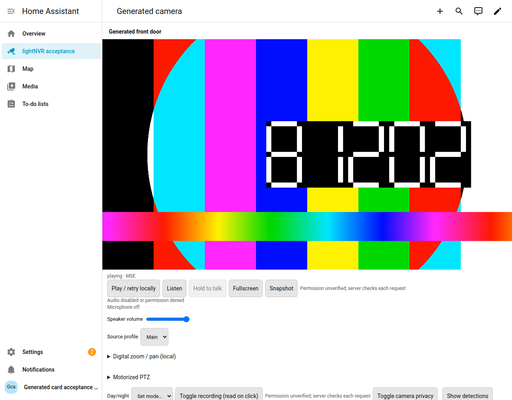

# lightNVR Camera Card

A Home Assistant dashboard card for an existing lightNVR server and its managed go2rtc instance. Discover authorized cameras, watch independent cards in native HA layouts, listen, and use WebRTC push-to-talk where the server, camera and browser permit it. No extra go2rtc add-on or camera registration is required. The single ES module bundles its runtime dependencies, including hls.js; it loads no runtime code from a CDN.

**Two-way audio requires Home Assistant to be opened in a secure context (normally trusted HTTPS), microphone permission, HTTPS/WSS media signaling for the HTTPS dashboard, and a compatible camera with lightNVR backchannel enabled and talk permission. A Traefik TLS sidecar can provide HTTPS to the NVR; it does not by itself secure the HA document or solve cross-origin MSE.**

Use the [same-origin connectivity recipe](docs/connectivity.md) for the full transport path. Direct cross-origin login and MSE are blocked by the tested lightNVR baseline. A TLS reverse proxy is not TURN and does not relay WebRTC UDP. [TLS and talk requirements](docs/tls-and-two-way-audio.md) explain localhost, internal/external HA URLs, ICE and browser permissions.



Actual HA 2026.11.1 in Chromium 156, playing a generated 1920-pixel test pattern through MSE. This is an isolated fixture screenshot, not a physical camera or talk demonstration. Also see the actual-HA [two-card grid](docs/images/ha-generated-grid.png) and [discovery/editor YAML generation](docs/images/ha-generated-editor.png). [Screenshot provenance](docs/images/README.md).

## Install

Repository: <https://github.com/halcycon/lightnvr-camera-card>. The verified development bundle is included in `main`. Authenticated custom-repository install/upgrade is not tested; no default catalog inclusion or public tagged release is claimed. See [packaging and release preparation](docs/hacs-release.md).

### Home Assistant 2026.11: built-in Marketplace

Go to **Settings → Marketplace → Add from link**, connect GitHub when prompted, and enter `https://github.com/halcycon/lightnvr-camera-card`. Choose Dashboard if type detection asks, then open the repository and install. Use the resource URL shown by the install dialog; current Marketplace resources use `/local/community/lightnvr-camera-card/lightnvr-camera-card.js`. For YAML-managed resources add it as `type: module` yourself. Do not also register a second copy.

Marketplace replaces the separate HACS integration on this HA version. Do not install HACS 2.0.5 into current HA. See the [official Marketplace instructions](https://www.home-assistant.io/integrations/marketplace/).

### Older HA with HACS

For the legacy HA 2026.10.4 / HACS 2.0.5 acceptance target, open HACS → three-dot menu → Custom repositories. Enter the repository URL and choose **Dashboard** (backend category `plugin`), add, find the card and download. Confirm a JavaScript module resource at `/hacsfiles/lightnvr-camera-card/lightnvr-camera-card.js` (keep HACS's cache query). If resources are YAML-managed, add that resource manually. This is a custom repository; default HACS/catalog inclusion is a separate reviewed submission.

### Manual `/local/` installation

Download `lightnvr-camera-card.js` from a versioned GitHub release when available. Before the first release, use the verified [development bundle from main](https://raw.githubusercontent.com/halcycon/lightnvr-camera-card/main/dist/lightnvr-camera-card.js); source files and GitHub's source ZIP alone are not a built card. Copy the bundle to `<HA config>/www/lightnvr-camera-card/lightnvr-camera-card.js`. The bundle banner includes the complete [license](LICENSE) and [third-party notices](THIRD_PARTY_NOTICES.md), so the single file downloaded by HACS carries its distribution notices. Release downloads also include those files separately; preserve the notices when redistributing.

Enable Advanced mode in your HA profile if needed, then open Settings → Dashboards → three-dot menu → Resources. Register `/local/lightnvr-camera-card/lightnvr-camera-card.js?v=0.1.0` as **JavaScript module**. For YAML resources:

```yaml
lovelace:
  resources:
    - url: /local/lightnvr-camera-card/lightnvr-camera-card.js?v=0.1.0
      type: module
```

Restart HA if you just created `www`. Reload the frontend after installing. For manual upgrades replace the file, change the `v` query, and hard-refresh/reload the Companion frontend cache. Keep exactly one resource registration across manual, HACS and Marketplace installs. Verify the resource returns JavaScript, not a login page or 404.

## Add a card

Edit a dashboard → Add card → **lightNVR Camera Card**, or use the manual card editor:

```yaml
type: custom:lightnvr-camera-card
server: /lightnvr/front/
stream: front_door
credential_storage: session
```

The server path is a placeholder requiring the [HA-origin routing recipe](docs/connectivity.md). Use Connect/discovery in the visual editor to select a permitted camera and main/sub profile. Session credentials are entered interactively and omitted from saved config; reloads can require login. Dashboard-stored credentials are visible to everyone who can read its configuration. A masked password field is not a vault; UI dashboards do not promise `!secret` support.

The editor offers transport order, audio/PTT, controls, layout and playback visibility settings, plus explicit legacy import preview. Multi-camera YAML generation omits login credentials and redacts TURN secrets for review; paste the generated cards/grid yourself. It cannot silently insert sibling cards. See the [configuration reference and exact migration mapping](docs/configuration.md), [single card](examples/cards/single.yaml), [panel view](examples/cards/panel.yaml) and [native grid](examples/cards/grid.yaml).

Speaker playback starts muted; browser autoplay policy may require **Listen** or **Play / retry locally**. Microphone capture requires a deliberate gesture, and never resumes automatically after fallback or reconnect. MSE/HLS fallback can add latency and removes talk. Local digital zoom/pan is supported; camera-specific fisheye/dewarping remains in the NVR web UI. Motorized controls depend on capability and permission. Recording, privacy and refresh can affect other viewers and require confirmation. Timeline links require an explicit `viewer_url` for the real NVR web UI, not the API-only proxy.

## Verified scope

| Component | Evidence and limits |
| --- | --- |
| lightNVR | Official **0.48.0**, OCI revision `4e578c1dac4a21688b420c8fc852f741d62efd2e`; relevant source matches research `8983888a19fef2040c48eee0a4ce56db5dafeb85`. The research SHA itself was not built/run. Managed go2rtc reports `1.9.15+dev.`; see [upstream provenance](docs/upstream-contract.md). |
| Proxy | Traefik **3.7.17** + scoped Node **22.22.2** helper: actual login, authenticated WSS, SDP and HLS paths/denials verified. [Receipt and boundaries](docs/connectivity.md). |
| Browser/media | Chromium **156.0.8078.73**, Linux: actual isolated lightNVR WebRTC/MSE/HLS decoded generated frames using Node TLS/helper inside the container network. This adapter evidence is separate from HA acceptance. |
| Current HA | **2026.11.1** Container in Chromium **156**: the **13-check actual-HA matrix passed**, including real snapshot download and editor preview. Authenticated GitHub Marketplace/catalog installation and upgrade are **not tested**. |
| Legacy HA | **2026.10.4** Container: the same **13-check actual-HA matrix passed** on a fresh generated fixture, including snapshots and discovery. The setup creates `www` before startup. Authenticated HACS **2.0.5** installation/upgrade is **not tested**. |
| Other devices | Firefox, Safari/native HLS, iOS/Android Companion and physical camera talk/PTZ are unverified. Playwright mocks or WebKit are not device proof. |
| Older lightNVR | No compatibility claim. Missing summary discovery currently blocks playback even with a manual source. Missing capability fields stay unknown; no administrative discovery or permission bypass is attempted. |

The current-HA matrix used generated media and verified MSE/HLS decoding at 1920-pixel frame width; injected WebRTC 502 → MSE fallback; two independent grid cards and removal isolation; Sections, reload and native visibility conditions; HA metadata updates preserving player/authentication/speaker/volume; explicit retry preserving volume; real editor discovery, selection and grid YAML generation; injected 403 with no fallback; and zero `getUserMedia` calls across navigation. Injected failures establish card behavior under those test conditions; they do not establish a real upstream outage or denial scenario. These actual-HA checks are separate from authenticated GitHub catalog installation/upgrade and physical camera talk.

The detailed [verification matrix](docs/verification.md) separates actual results from untested devices and store installation. Maintainers can use the [operator handoff](docs/HANDOFF.md) and [reproducible fixture suite](tests/e2e/README.md).

Use [troubleshooting](docs/troubleshooting.md) for deployment failures. [Release preparation](docs/hacs-release.md) lists the remaining installation, browser and marketplace review gates. GPL-3.0-or-later; see [LICENSE](LICENSE) and [THIRD_PARTY_NOTICES.md](THIRD_PARTY_NOTICES.md).
